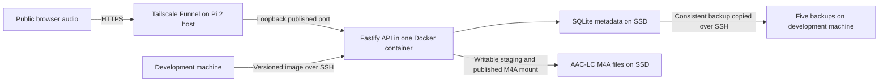

# SongStreamer implementation plan

Status: approved implementation basis. The backend, local release artifacts, and initial Pi 2 deployment are complete; public Funnel, content, capacity, and remaining host acceptance checks remain pending.

## Outcome and boundaries

A public Fastify/TypeScript API streams a shared library of 50–100 songs from an SSD attached to Raspberry Pi 2 Model B Rev 1.1. The KeyStack kiosk can inspect one YouTube video, confirm editable metadata, and enqueue a native AAC-LC import. Target ten simultaneous listeners using native browser audio. Users need no VPN, account, or login. There are no playlists, artwork, or search features, and the importer never scans or transcodes audio.

All coding work uses GPT 5.6 Luna with max thinking effort.

## Architecture

## Stack and tools

See [stack.md](stack.md) for the full inventory and verification status.

- TypeScript compiled to JavaScript; Node.js 22; Fastify v5; npm lockfile.
- SQLite through Node's built-in node:sqlite (Node >=22.13), with prepared SQL and ordered migrations. No ORM or additional native addon. Its Node 22 API is still in active development; isolate database access and verify against the pinned runtime. The repository's OpenAPI validation/test toolchain raises the local `npm ci`/test minimum to Node >=22.19. For this tiny read-mostly catalog, synchronous reads are bounded; streaming itself remains asynchronous.
- One multi-stage Dockerfile, Docker Compose, Docker Buildx targeting linux/arm/v7. Build on the development machine, not the Pi.
- Tailscale host service with public Funnel HTTPS; no private-network requirement for listeners.
- SSH, Docker image save/load, versioned artifacts, previous-image retention, consistent SQLite backups.
- yt-dlp with bundled `yt-dlp-ejs`, FFmpeg, and ffprobe for the server-side native import worker; SQLite CLI for manual maintenance/recovery; curl for HTTP checks.
- Node built-in test runner and a bounded streaming load script for MacBook-side verification. Browser playback remains a deployment acceptance step; current user constraints prohibit Pi 5 access or browser testing.
- Exact supported dependency patches and the image digest are pinned in the lockfile and Dockerfile. Docker's Raspbian ARMv7 installation route is captured in `tools/bootstrap-pi.sh`; it still requires the user's interactive privileged run.

## API and metadata

| Route | Behavior |
| --- | --- |
| GET /songs | Deterministic listing with public metadata; no filesystem paths in responses |
| GET /songs/:id | Metadata for one song; 404 when absent |
| GET /songs/:id/audio | Native browser playback and seeking; 404 when the song or file is absent |
| HEAD /songs/:id/audio | Same resource headers without an audio body |
| GET /health | Minimal catalogue health response, without sensitive host details |
| POST /api/v1/import/inspect | Validate one YouTube video and return editable metadata plus compatible AAC-LC formats |
| POST /api/v1/import/jobs | Queue a confirmed metadata import; public by design and without deduplication |
| GET /api/v1/import/jobs/:id | Poll import status and measured audio fields |
| POST /api/v1/import/jobs/:id/retry | Retry a failed job from an empty staging directory |
| GET /api/v1/import/health | Check yt-dlp, FFmpeg, and ffprobe availability |

Stored fields: stable ID, title, artist, optional album, positive duration, unique relative file path. Treat IDs as opaque and metadata as manually supplied. Use parameterized SQL, schema constraints, and path containment checks. Do not accept arbitrary filesystem paths from requests. Local username display belongs to the future frontend only.

## Audio delivery

Only unencrypted AAC-LC in .m4a; preserve compatible source bitrate/sample rate. Validate actual file contents before publication. Prepare fast-start M4A where necessary outside the Pi, without re-encoding compatible AAC. Serve audio/mp4.

Support full responses and standard single byte ranges, including open-ended and suffix ranges, correct 206/416 handling, Content-Length, Content-Range, Accept-Ranges, HEAD, and conditional range behavior. Document a standards-compliant policy for multiple ranges rather than returning a misleading partial response. Disable audio compression, stream with backpressure, and stop file reads when clients disconnect. Do not buffer entire songs in memory or query SQLite for every audio chunk.

## Persistence and maintenance

Use dedicated directories beneath the existing /srv/keystack-data SSD mount: songstreamer/audio, songstreamer/data, and songstreamer/backups. The audio mount is writable because the importer stages under `.import-staging` and atomically publishes into `imports/`; SQLite data stays outside the image. Run the API without root privileges and bound logs/resources. Startup explicitly requires the SSD so its existing nofail mount cannot redirect writes to the SD card.

Provide executable, verified maintenance instructions with exact SQL: stop the API, take a consistent database backup, validate/copy a complete audio file using staging and atomic publication, update SQLite in a transaction, check consistency, restart, and verify listing/playback. Replace a recording using a new ID/path; document removal and missing-file behavior. Keep original songs elsewhere.

## Build and initial deployment

1. Verify the local Docker daemon/Buildx builder and ARMv7 build support. The local builder has now loaded the pinned ARMv7 image successfully.
2. Verify built-in node:sqlite against the pinned Node 22 ARMv7 runtime. Dependencies and the runtime image are pinned; no external SQLite addon is used.
3. Implement API/schema/migrations and required HTTP behavior; run targeted tests and build the production image away from the Pi.
4. Verify and install the selected Docker Engine/Compose route on Raspbian 13 and Tailscale on Pi 2. Configure persistent SSD directories, ownership, SSD-dependent startup, limits, and loopback-only host publication. This is complete; Docker's memory controller still needs a privileged boot-configuration follow-up.
5. Transfer/load the versioned image over SSH, initialize schema, and start with Compose. This is complete for the empty initial library; health and listing checks pass on the Pi 2.
6. Configure public HTTPS Funnel and verify access from outside the tailnet. Record the actual public URL; do not invent a hostname.
7. Add a validated test song using the manual procedure, then run acceptance tests before adding the collection.

## New releases and recovery

Build/test a versioned ARMv7 image locally; transfer it over SSH; create a consistent SQLite backup and copy it to the development machine; retain the latest five. Keep the previous image/configuration. Apply migrations and restart with Compose; a brief listening interruption is accepted. Verify health, listing, playback, and seeking. Roll back the image on failure; restore its matching database backup when schema changes prevent backward compatibility. Verify restore once before treating recovery as complete.

## Acceptance and unresolved evidence

- Idle Docker infrastructure adds less than 100 MiB memory compared with the engine-stopped baseline. Measure comparable host memory conditions and report process memory as supporting evidence; image size and one docker stats reading do not establish engine overhead.
- Ten concurrent listeners sustain playback through the actual public Funnel path without sustained swapping or server-induced stalls. Exercise different songs, seeking, and cancellation. Record CPU, memory, startup/seek observations, logs, and test duration. Ten is a capacity target, not a promised hard public-user limit.
- Funnel's non-configurable bandwidth limits and home upstream capacity must pass the real test; local performance cannot substitute. If this fails, revisit the tunnel choice before declaring deployment successful.
- Pi 5 actual AAC playback/seek is historically unverified. Further Pi 5 access and browser testing are explicitly deferred by the user; do not run the old harness. See [browser-compatibility.md](browser-compatibility.md) and [current-constraints.md](current-constraints.md).
- Test current Chrome, Edge, Firefox with AAC platform support, Safari on macOS/iOS, and Android Chrome. Record exact versions and pass/fail/not-tested; do not promise every Chromium build supports AAC.
- Exercise valid/invalid ranges, HEAD, unavailable files, path containment, client cancellation, migrations, missing SSD startup, reboot recovery, release rollback, and database restore.
- Initial Pi 2 runtime is Node 22 on 32-bit ARMv7. Migrate to supported 64-bit hardware/runtime before Node 22 support ends on 2027-04-30; do not silently continue an unsupported runtime.

## Deliverables

Backend source and lockfile, migrations/schema, Dockerfile and Compose configuration, verified release/rollback and manual-library commands, stack/version inventory, HTTP API documentation, backup/restore procedure, and recorded compatibility/load results. Existing [deployment](deployment.md) and [browser](browser-compatibility.md) documents are completed against the real implementation. Unrun checks remain explicitly marked.
